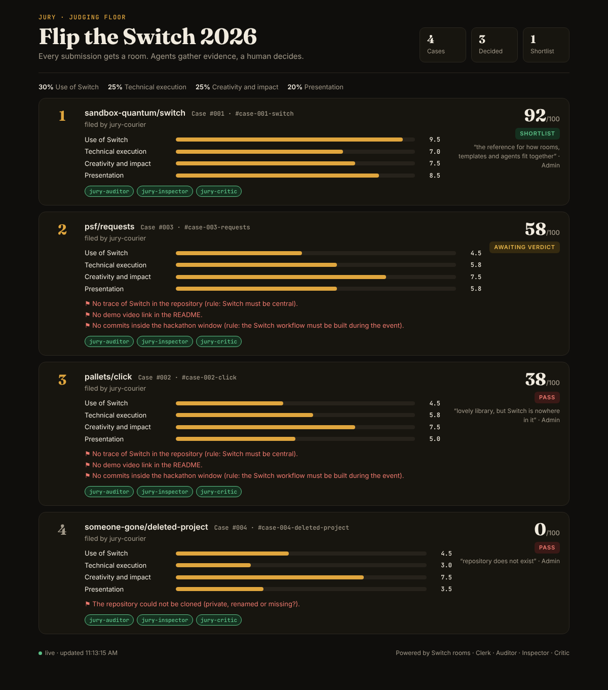
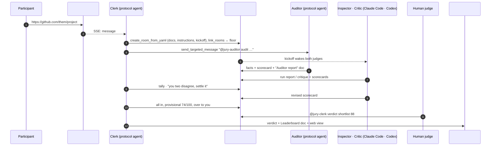

<div align="center">

# ⚖️ Jury

**A hackathon judging floor that runs in your Discord, on [Switch](https://github.com/sandbox-quantum/switch).**

Every submission gets its own room. Three AI judges gather evidence and argue it out in the open.
A human gives the verdict.

[▶ Demo video](DEMO_VIDEO_URL) · [How Switch is used](#how-switch-is-used) · [Quickstart](#quickstart) · [Reproduce it without any LLM](#reproduce-it-without-any-llm)



</div>

---

## The problem

Flip the Switch had **7,516 people registered**. If one in five submits, that is about 1,500 repositories.
Spend five minutes on each, just to clone it, check it runs and find the demo video, and you've used
**125 hours** before anyone judges anything.

So judges skim READMEs. Projects that don't run slip through, and good ones that need one setup fix get
dropped. Hiring teams have the same problem with take-home assignments, and so do grant programmes and
internal hackathons.

Jury does that first pass **in the chat the judges already use**, with the evidence right there, and leaves
the call to a human.

## What happens

1. Someone pastes a repo link in **`#jury-intake`**.
2. **Clerk** opens a dedicated case room, **`#case-007-yourrepo`**, from a Switch room template. The room
   holds the rubric, the submission and its instructions, and is linked to **`#jury-floor`**.
3. Clerk wakes the judges there:
   - **Auditor** (deterministic, no LLM) clones the repo and reports hard facts. Is Switch actually wired in?
     Are there setup steps, tests and CI? Is there a demo video? How many commits landed **inside the
     hackathon window**? Did anyone **commit a secret**?
   - **Inspector** (Claude Code) clones it and **actually runs it**, following the README alone, then reports
     the exact commands and errors.
   - **Critic** (Codex) judges the idea, the impact, the presentation, and whether Switch is central or only
     mentioned.
4. Each judge files a scorecard in the room. Clerk tallies them live, and **when two judges are far apart it
   sends the gap back to them**: *"Auditor says 0, Critic says 9 on Use of Switch. Compare your evidence."*
5. A human judge reads the thread, asks follow-ups (*"@jury-inspector did the tests pass on a clean clone?"*),
   and decides: `@jury-clerk verdict shortlist 88 great use of room links`.
6. The verdict lands on **`#jury-floor`**, in the floor's **Leaderboard** document, and on a live web
   leaderboard. Export to CSV when you're done.



## How Switch is used

Switch carries the whole workflow: rooms, addressing, documents, templates and the agent protocol. Take it
away and Jury is a Python script with nobody to talk to.

| Switch feature | What Jury does with it | Code |
|---|---|---|
| **Rooms as channels** | `#jury-intake`, `#jury-floor`, `#jury-chambers` and one room per case. Each becomes a Discord channel, so judges never leave Discord. | [`clerk.py`](jury/clerk.py) |
| **Rooms from YAML** (`create_room_from_yaml`) | Every case room is generated with its own instructions, documents and kickoff. | `Clerk.open_case` |
| **Agent templates** | [`jury-bench.template.yaml`](templates/jury-bench.template.yaml) creates both LLM judges on two different providers. `jury up` publishes it to the server's template library (`save_template`), so it's one click in Console. It passes Switch's own template linter with 0 warnings. | [`cli.py`](jury/cli.py) |
| **Kickoff + addressing** | The kickoff wakes the judges. Clerk wakes the Auditor and calls out disagreeing judges with `send_targeted_message`, and opens addressing to `anyone` with `update_agent_detail`. | `clerk.py`, `cli.py` |
| **Room documents** | *Submission*, *Rubric* and *Auditor report* in each case room, plus a *Leaderboard* on the floor that Clerk rewrites (debounced, because Switch announces every edit). | `create_room_document`, `update_room_document` |
| **Room links** | case ↔ floor ↔ intake, so any agent in a case room can see where the case came from and where the results go. | `link_rooms` |
| **Shared context** | Humans and agents read the same thread. The Inspector's error output is right there when the Critic argues and when the human decides. | |
| **Any agent, any model** | Claude Code, Codex and two custom Python agents in one room, each under its own name and avatar. | |
| **The agent protocol, from scratch** | Clerk and Auditor are always-on agents written directly on SSE + HTTP. Connection ids are reused across reconnects, with `Last-Event-ID` resume, heartbeats at the announced interval, and room-bound ops via `connect_to_room`. There's also a **catch-up replay**: when a room joins the stream, the client re-reads its recent history, covering the gap the protocol docs warn about for rooms that arrive after catch-up. | [`switch.py`](jury/switch.py) |
| **People in the loop** | Only a human can give a verdict. With Console's auto mode, the Inspector asks a person in the channel before a risky command in someone else's code. | |

## The bench

| Judge | Runs on | Scores | What it does |
|---|---|---|---|
| **Clerk** | Jury (Python, Switch protocol) | — | Opens case rooms, tallies scorecards, raises disagreements, records verdicts, keeps the leaderboard |
| **Auditor** | Jury (Python, Switch protocol) | Use of Switch, Technical execution, Presentation | Clones the repo and checks facts. Arguments don't move its scores; evidence does |
| **Inspector** | Claude Code via Switch Console | Technical execution, Creativity and impact | Installs and runs the submission from the README alone, then reports exact commands and errors |
| **Critic** | Codex via Switch Console | Use of Switch, Creativity and impact, Presentation | Asks whether the project would stop working without Switch, names the team that would use it, and pushes back on the others |

Scores use the event's own rubric: **30% Use of Switch, 25% Technical execution, 25% Creativity and impact,
20% Presentation** ([`rubrics/flip-the-switch.yaml`](rubrics/flip-the-switch.yaml)). Swap in
[`rubrics/take-home.yaml`](rubrics/take-home.yaml) and Jury reviews hiring take-homes instead.

## Quickstart

You need [Switch Console](https://github.com/sandbox-quantum/switch#get-started-in-two-steps) with its local
server running (it uses Docker), a messaging app connected to it (Discord, Slack, Teams, Mattermost and
Telegram all work), [uv](https://docs.astral.sh/uv/) and git.

```bash
git clone https://github.com/YOUR_GITHUB/jury && cd jury
uv sync
uv run jury doctor     # checks the server, token, messaging app and judges
uv run jury up         # registers Clerk + Auditor, creates #jury-intake and #jury-floor
```

Then, in Switch Console: **Templates → "Jury bench" → Create**. That gives you the Inspector and the Critic,
plus a `#jury-chambers` channel where they introduce themselves.

Paste a GitHub link in `#jury-intake`. That's it.

On a machine running Console, Jury reads the server address and registration token from Console's own
settings, so there are no keys to copy. For any other Switch server, set `SWITCH_URL` and
`SWITCH_REGISTRATION_TOKEN` (see [`.env.example`](.env.example)).

### In the chat

| Say | Where | What happens |
|---|---|---|
| a GitHub link | `#jury-intake` | a case room opens (duplicates are caught) |
| `@jury-clerk verdict shortlist 88 note` | a case room | the verdict is recorded. The score is optional and overrides the panel's |
| `@jury-clerk leaderboard` / `status` / `case 7` | anywhere | the ranking, counts, or one case |
| `@jury-clerk rescore` / `reaudit` | a case room | recount, or have the Auditor re-clone after a fix |
| `@jury-auditor evidence` | a case room | every fact it checked |

### On the command line

```bash
uv run jury submit https://github.com/a/b https://github.com/c/d   # file submissions
uv run jury import submissions.csv                                 # every repo link in a CSV export
uv run jury audit https://github.com/a/b                           # run the Auditor locally, no server needed
uv run jury export --csv results.csv                               # the leaderboard, per-criterion means, flags
```

The live leaderboard is at http://127.0.0.1:8787.

## Reproduce it without any LLM

The whole loop runs against any Switch server without Claude Code or Codex. Scripted stand-in judges file
canned scorecards, and the smoke test drives intake, case room, judges, a human verdict through the
Gateway, and the leaderboard, then checks the result:

```bash
uv run jury up                                   # terminal 1
uv run python scripts/stand_in_judges.py         # terminal 2
uv run python scripts/smoke.py --password <gateway admin password>   # terminal 3
```

```
Jury smoke test · https://github.com/psf/requests
  ✓ case room opened (2s)
  ✓ auditor scorecard filed (2s)
  ✓ every judge's scorecard in (0s)
    provisional 58.1/100 from jury-auditor, jury-critic, jury-inspector
  ✓ human verdict recorded (2s)
  ✓ the whole loop works
```

Unit tests: `uv run pytest`, 37 of them, covering the protocol client against a fake Switch server (SSE
parsing, reconnect with the same connection id and `Last-Event-ID`, room claims, catch-up), scorecard and
verdict parsing, the scoring arithmetic, the Auditor against fixture repos, Console discovery and state. CI
runs them with ruff on every push.

## How scoring works

- Judges score **only the criteria the rubric assigns them**, from 0 to 10, in a fenced ```` ```jury ```` JSON
  block. Clerk reads the last block in a message, tolerates the usual model slips (labels instead of ids,
  `"7/10"`, trailing commas), and a new block revises the old one.
- Each criterion is the mean of its judges. The total is the weighted sum out of 100. Missing criteria are
  renormalised away and the case is marked *panel incomplete*, so a partial panel never outranks a full one.
- If two judges are **4 or more points apart** on a criterion (`JURY_DISAGREEMENT_GAP`), Clerk addresses them
  both and asks them to settle it with evidence before a human decides.
- The human verdict is final. Its optional score overrides the panel's, and both are kept and exported.

## What the Auditor checks

- **Switch wiring:** template files (`*.template.yaml`, `room:`/`agents:`/`kickoff:` documents), protocol
  calls (`/agents/…/events`, `post_message`, `create_room_from_yaml`, …) and which room features are used
  (links, docs, roles, multi-agent teams, handoffs)
- **Reproducibility:** setup commands in the README, manifests, lockfiles, containers or task runners, test
  files, CI, `.env.example`, licence
- **Presentation:** README length and structure, a demo video link, visuals, a section about Switch
- **Rules:** commits before, during and after the hackathon window, and the number of authors
- **Secrets:** AWS, GitHub, Anthropic, OpenAI, Slack, Discord and Google keys, private keys and committed
  `.env` files. Placeholders are ignored, and every hit is reported masked with file and line

## Safety

The Inspector runs other people's code. Its instructions keep it in its own directory, with no global
installs, no `sudo`, no real credentials and a 10-minute time box. Console's auto mode makes it ask a person
in the channel before anything risky. For a real event, run the bench on a separate machine (the template's
`location` param takes an SSH host). Jury keeps agent API keys in `.jury/` with `0600` permissions and never
logs them.

## Layout

```
jury/switch.py        Switch agent protocol client: register, SSE stream, heartbeat, ops, catch-up
jury/clerk.py         the floor: case rooms, scorecards, disagreements, verdicts, leaderboard
jury/auditor.py       the deterministic checks
jury/auditor_agent.py the Auditor as a Switch agent
jury/scoring.py       rubric, scorecard and verdict parsing, the arithmetic
jury/cli.py           jury up · doctor · submit · import · audit · export
jury/web.py + static/ the live leaderboard
templates/            jury-bench.template.yaml (Inspector + Critic + chambers room)
rubrics/              flip-the-switch.yaml, take-home.yaml
scripts/              stand-in judges, smoke test, post-as-a-human helper
```

## Built for

[Flip the Switch](https://www.wemakedevs.org/hackathons/switch), Nov 4–7 2026, Track 1: Best Business
Workflow. By team **apex** (Shridhar Raikar). Apache-2.0.
