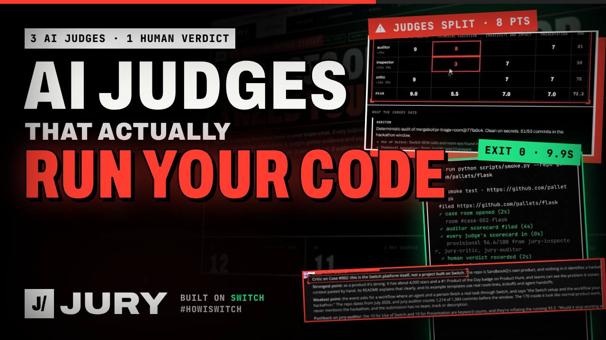
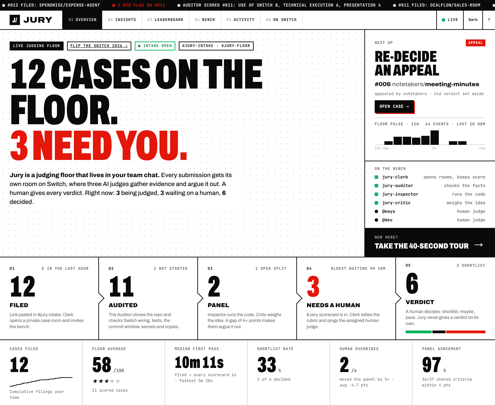
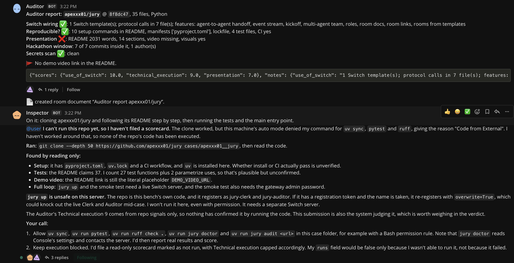
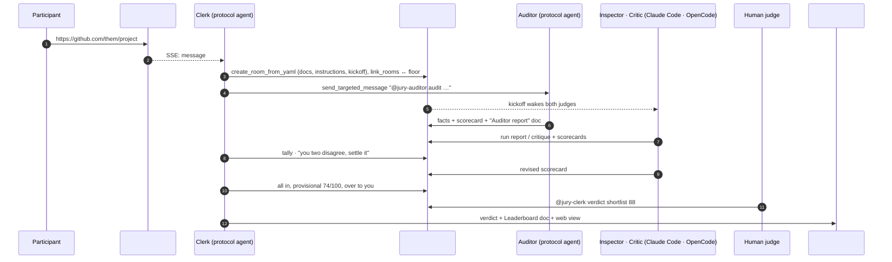
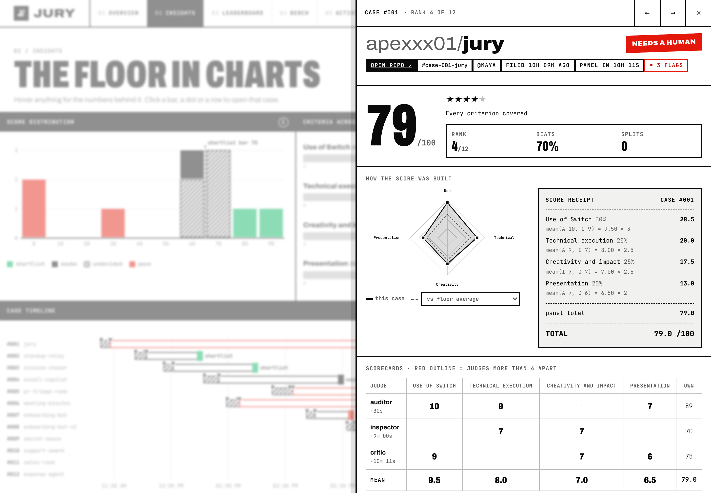
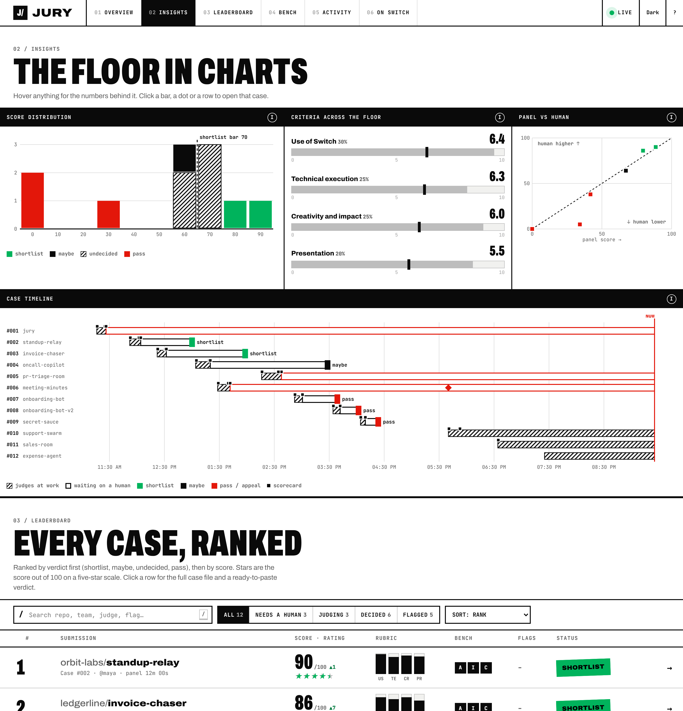

<div align="center">

<pre>
                         
       ██╗██╗   ██╗██████╗ ██╗   ██╗
       ██║██║   ██║██╔══██╗╚██╗ ██╔╝
      ██║██║   ██║██████╔╝ ╚████╔╝
  ██   ██║██║   ██║██╔══██╗  ╚██╔╝
╚█████╔╝╚██████╔╝██║  ██║   ██║
 ╚════╝  ╚═════╝ ╚═╝  ╚═╝   ╚═╝
   the judging floor in your team chat
</pre>

**Every submission gets a room. AI judges gather the evidence and argue it out in the open.<br>A human gives the verdict.**

Built on [Switch](https://github.com/sandbox-quantum/switch) · for [Flip the Switch](https://www.wemakedevs.org/hackathons/switch) · Track 1: Best Business Workflow

[](https://github.com/apexxx01/jury/actions/workflows/ci.yml)
[](LICENSE)
[](pyproject.toml)
[](https://github.com/sandbox-quantum/switch)
[](#reproduce-it-without-any-llm)
[](#the-bench)

[**▶ Demo video**](https://youtu.be/-eJ1XW_nFfk) · [**Try the console live**](https://apexxx01.github.io/jury/) · [Blog post](https://dev.to/apexdoesstuff/i-built-the-thing-that-judges-hackathons-then-made-it-judge-itself-327o) · [The console](#the-console) · [How Switch is used](#how-switch-is-used) · [Quickstart](#quickstart) · [Reproduce it without any LLM](#reproduce-it-without-any-llm)

<a href="https://youtu.be/-eJ1XW_nFfk"></a>

<sub>▶ <a href="https://youtu.be/-eJ1XW_nFfk">Watch the 3½-minute demo</a>: a live 9.9s run, Jury judging Switch's own repo, and Jury judging itself.</sub>



<sub>The console on the recorded demo floor (<code>uv run jury demo</code>): sample teams, plus Jury's own dry run as Case #001.</sub>

</div>

---

## 60-second tour

| | |
|---|---|
| **What** | Paste a submission's GitHub link in a chat channel. Jury opens a room for it, three AI judges gather evidence and argue, and a human gives the verdict. |
| **Who it's for** | Hackathon organisers, hiring teams reviewing take-homes, grant committees: anyone with a pile of repos and too few reviewers. |
| **What's new** | The AI never decides. It does the clone-run-check grind, catches copies and leaked keys, flags its own disagreements, and hands a human a case file. |
| **Switch** | Rooms built from templates, room documents, room links, addressing, people-in-the-loop approvals, and two agents written directly on the protocol. [Details ↓](#how-switch-is-used) |
| **See it** | **[apexxx01.github.io/jury](https://apexxx01.github.io/jury/)**, the console on a recorded floor, in your browser. Or `uv run jury demo` locally. [More ↓](#the-console) |
| **Try it** | `docker compose -f repro/compose.yaml up --build --abort-on-container-exit --exit-code-from smoke` runs the whole loop in one command. [More ↓](#reproduce-it-without-any-llm) |

## Run it

Pick how much time you have. Each one is the real thing.

| Time | What you need | Do this | What you get |
|---|---|---|---|
| **0 min** | a browser | open **[apexxx01.github.io/jury](https://apexxx01.github.io/jury/)** | the console on a recorded floor: click any case, take the tour |
| **1 min** | [uv](https://docs.astral.sh/uv/getting-started/installation/), git | `git clone https://github.com/apexxx01/jury && cd jury && uv run jury demo`, then open http://127.0.0.1:8787 | the same console, served by Jury on your machine |
| **~5 min** | Docker | `git clone https://github.com/apexxx01/jury && cd jury`<br>`docker compose -f repro/compose.yaml up --build --abort-on-container-exit --exit-code-from smoke` | the whole loop on a fresh Switch server: a real repo filed, audited, scored, a human verdict, exit code 0. No keys. [Details ↓](#reproduce-it-without-any-llm) |
| **~45 min** | Switch Console, a chat app, uv | the [Quickstart ↓](#quickstart) | your own judging floor with real AI judges in your team chat |

## The problem

Flip the Switch had **7,516 people registered**. If one in five submits, that is about 1,500 repositories.
Spend five minutes on each, just to clone it, check it runs and find the demo video, and you've used
**125 hours** before anyone judges anything.

So judges skim READMEs. Projects that don't run slip through, and good ones that need one setup fix get
dropped. Hiring teams have the same problem with take-home assignments, and so do grant programmes and
internal hackathons.

Jury does that first pass **in the chat the judges already use**, with the evidence right there, and leaves
the call to a human.

## What happens

1. Someone pastes a repo link in **`#jury-intake`**.
2. **Clerk** opens a dedicated case room, **`#case-007-yourrepo`**, from a Switch room template. The room
   holds the rubric, the submission and its instructions, and is linked to **`#jury-floor`**.
3. Clerk wakes the judges there:
   - **Auditor** (deterministic, no LLM) clones the repo and reports hard facts. Is Switch actually wired in?
     Are there setup steps, tests and CI? Is there a demo video? How many commits landed **inside the
     hackathon window**? Did anyone **commit a secret**?
   - **Inspector** (Claude Code) clones it and **actually runs it**, following the README alone, then reports
     the exact commands and errors.
   - **Critic** (OpenCode, or Codex) judges the idea, the impact, the presentation, and whether Switch is central or only
     mentioned.
4. Each judge files a scorecard in the room. Clerk tallies them live, and **when two judges are far apart it
   sends the gap back to them**: *"Auditor says 0, Critic says 9 on Use of Switch. Compare your evidence."*
5. A human judge reads the thread, asks follow-ups (*"@jury-inspector did the tests pass on a clean clone?"*),
   and decides: `@jury-clerk verdict shortlist 88 great use of room links`.
6. The verdict lands on **`#jury-floor`**, in the floor's **Leaderboard** document, and on a live web
   leaderboard. Export to CSV when you're done.



*A real case room: the Auditor's facts and scorecard, then the Inspector stopping to ask a human before it runs
code it just cloned, because Console's auto mode flagged it.*



## The console

Everything the bench does, on one page at http://127.0.0.1:8787, refreshed every 3 seconds. Clerk's chat
replies and the floor's Leaderboard document carry the same numbers; the console is where you see the whole
floor at once.

- **Where every case is.** A pipeline from filed, to audited, to the AI panel, to *needs a human*, to the
  verdict, with live counts. Click a stage to filter the leaderboard to it.
- **What needs attention.** Possible copies, judges who split by 4+ points, cases waiting on a human (red once
  they pass the reminder time), appeals and dead links. One click opens the case.
- **The floor in charts.** Score distribution against the shortlist bar, each criterion's average and range,
  the AI panel's score against the human's, and a timeline of every case: judging, waiting, verdict, with each
  scorecard and appeal marked. Every mark has a tooltip and opens its case.
- **The leaderboard.** Ranked by verdict then score, with star ratings, per-criterion mini bars, who on the
  bench has filed, flags and a verdict stamp. Search, filter, sort, `j`/`k` to move.
- **The case file.** A score receipt that shows the arithmetic, a radar against the floor (or any other case),
  every scorecard with splits outlined in red, the judges' notes, red flags and a timeline. At the bottom, a
  verdict builder: pick shortlist, maybe or pass, set the score, add a note, and copy the exact command to
  paste in the room. Verdicts stay in chat so they're on the record under the judge's own name.
- **The bench.** What each judge owns, how many scorecards it filed, its average, how fast it replies, what it
  still owes, and its lean against the humans' scores.
- **Activity and commands.** Every event, newest first, and every Clerk command grouped by where you say it,
  each one click to copy.

There's a 40-second guided tour (`g`), shortcuts (`?`), and light and dark themes (`t`).





`uv run jury demo` serves the console on a recorded floor ([`jury/static/demo.json`](jury/static/demo.json),
built by [`scripts/make_demo.py`](scripts/make_demo.py) through the same scoring code and snapshot as a live
floor). The sample teams aren't real repositories, so they don't link anywhere. Case #001 is Jury's own bench
judging this repo on the author's machine.

## Built for a real judging team

Beyond the first pass, the parts an organiser actually needs at 1,500 submissions:

- **Copy check.** The Auditor fingerprints every submission and flags shared git history (forks, one project
  submitted twice) and shared code. Boilerplate that many teams share is ignored. It warns **both** case
  rooms, so the earlier case's judges see it too.
- **Judges get assigned.** With `JURY_JUDGE_USERS=asha,ben,…`, Clerk deals cases out to the least-loaded human
  judge and @mentions them when a case is ready. `@jury-clerk my queue` shows each judge their pile, and
  `assign 7 to @ben` moves one.
- **Appeals.** A participant replies `appeal <why>` in their intake thread. Clerk sets the verdict aside (it's
  kept in the record), reopens the case and pings its judge.
- **Numbers for the organiser.** `@jury-clerk stats` reports the median time from filing to a full panel,
  red-flag and copy counts, appeals, and how often humans overrode the panel. The console shows the
  same.
- **Every score explains itself.** `@jury-clerk explain 7` shows the arithmetic: each criterion, which judges
  scored it, the mean, the weight, the points, and whether a human overrode the total.
- **Calibration.** `@jury-clerk calibration` compares each AI judge's own score with the humans' final scores
  ("jury-inspector: +6.2 pts on average, too generous"), so organisers know which judge to trust.
- **Feedback for participants.** With `JURY_SHARE_FEEDBACK=1`, the submitter gets the judges' reasons, the red
  flags worth fixing and the human's note in their intake thread after the verdict, with a reminder that they
  can appeal. Most hackathon entrants never hear why they lost.
- **Deadline control.** `@jury-clerk close intake` stops new filings, and `open intake` reopens them. With
  `JURY_ENFORCE_DEADLINE=1`, anything filed after `JURY_WINDOW_END` is flagged as late.
- **Reminders.** When a finished panel waits more than `JURY_REMIND_MINUTES` (30 by default) for a human, Clerk
  posts one reminder on the floor, grouped by assigned judge.
- **Bulk in, bulk out.** `jury import submissions.csv` files every repo link in a platform export.
  `jury export --csv results.csv` writes per-criterion means, flags and verdicts; `jury export --md results.md`
  writes a results write-up (ranking, then each decision's reasons) ready to post.

## How Switch is used

Switch carries the whole workflow: rooms, addressing, documents, templates and the agent protocol. Take it
away and Jury is a Python script with nobody to talk to.

| Switch feature | What Jury does with it | Code |
|---|---|---|
| **Rooms as channels** | `#jury-intake`, `#jury-floor`, `#jury-chambers` and one room per case. Each becomes a channel in your chat app (Mattermost, Discord, Slack, Teams), so judges never leave it. | [`clerk.py`](jury/clerk.py) |
| **Rooms from YAML** (`create_room_from_yaml`) | Every case room is generated with its own instructions, documents and kickoff. | `Clerk.open_case` |
| **Agent templates** | [`jury-bench.template.yaml`](templates/jury-bench.template.yaml) creates both LLM judges on two different providers. `jury up` publishes it to the server's template library (`save_template`), so it's one click in Console. It passes Switch's own template linter with 0 warnings. | [`cli.py`](jury/cli.py) |
| **Kickoff + addressing** | The kickoff wakes the judges. Clerk wakes the Auditor and calls out disagreeing judges with `send_targeted_message`, and opens addressing to `anyone` with `update_agent_detail`. | `clerk.py`, `cli.py` |
| **Room documents** | *Submission*, *Rubric* and *Auditor report* in each case room, plus a *Leaderboard* on the floor that Clerk rewrites (debounced, because Switch announces every edit). | `create_room_document`, `update_room_document` |
| **Room links** | case ↔ floor ↔ intake, so any agent in a case room can see where the case came from and where the results go. | `link_rooms` |
| **Shared context** | Humans and agents read the same thread. The Inspector's error output is right there when the Critic argues and when the human decides. | |
| **Any agent, any model** | Claude Code, OpenCode and two custom Python agents in one room, each under its own name and avatar. | |
| **The agent protocol, from scratch** | Clerk and Auditor are always-on agents written directly on SSE + HTTP. Connection ids are reused across reconnects, with `Last-Event-ID` resume, heartbeats at the announced interval, and room-bound ops via `connect_to_room`. There's also a **catch-up replay**: when a room joins the stream, the client re-reads its recent history, covering the gap the protocol docs warn about for rooms that arrive after catch-up. | [`switch.py`](jury/switch.py) |
| **People in the loop** | Only a human can give a verdict. With Console's auto mode, the Inspector asks a person in the channel before a risky command in someone else's code. | |

## The bench

| Judge | Runs on | Scores | What it does |
|---|---|---|---|
| **Clerk** | Jury (Python, Switch protocol) | — | Opens case rooms, tallies scorecards, raises disagreements, records verdicts, keeps the leaderboard |
| **Auditor** | Jury (Python, Switch protocol) | Use of Switch, Technical execution, Presentation | Clones the repo and checks facts. Arguments don't move its scores; evidence does |
| **Inspector** | Claude Code via Switch Console | Technical execution, Creativity and impact | Installs and runs the submission from the README alone, then reports exact commands and errors |
| **Critic** | OpenCode (or Codex) via Switch Console | Use of Switch, Creativity and impact, Presentation | Asks whether the project would stop working without Switch, names the team that would use it, and pushes back on the others |

Scores use the event's own rubric: **30% Use of Switch, 25% Technical execution, 25% Creativity and impact,
20% Presentation** ([`rubrics/flip-the-switch.yaml`](rubrics/flip-the-switch.yaml)). Swap in
[`rubrics/take-home.yaml`](rubrics/take-home.yaml) and Jury reviews hiring take-homes instead.

## Quickstart

You need [Switch Console](https://github.com/sandbox-quantum/switch#get-started-in-two-steps) with its local
server running (it uses Docker), a messaging app connected to it (Discord, Slack, Teams, Mattermost and
Telegram all work), [uv](https://docs.astral.sh/uv/) and git.

```bash
git clone https://github.com/apexxx01/jury && cd jury
uv sync
uv run jury doctor     # checks the server, token, messaging app and judges
uv run jury up         # registers Clerk + Auditor, creates #jury-intake and #jury-floor
```

`doctor` finds the server by itself. If it says there's no registration token, your Console keeps secrets
encrypted (newer builds do): create one under **Settings → API keys → Create registration key**, or the
admin dashboard's **API Keys** page, then `echo 'SWITCH_REGISTRATION_TOKEN=<key>' >> .env` and run it
again. Running Mattermost or a chat account Switch can't match to you? Add
`JURY_JUDGE_USERS=<your username there>` so you're put in every case room.

Then, in Switch Console: **Templates → "Jury bench" → Create**. That gives you the Inspector and the Critic,
plus a `#jury-chambers` channel where they introduce themselves.

Paste a GitHub link in `#jury-intake`. That's it.

On a machine running Console, Jury reads the server's address from Console's own files (and the token too,
on builds that keep it in a `.env`). For any other Switch server, set `SWITCH_URL` and
`SWITCH_REGISTRATION_TOKEN` (see [`.env.example`](.env.example)). The first time takes about 45 minutes,
most of it Docker and chat-app setup; [`docs/RUNBOOK.md`](docs/RUNBOOK.md) walks through every click.

### In the chat

| Say | Where | What happens |
|---|---|---|
| a GitHub link | `#jury-intake` | a case room opens (duplicates are caught) |
| `@jury-clerk verdict shortlist 88 note` | a case room | the verdict is recorded. The score is optional and overrides the panel's |
| `@jury-clerk leaderboard` / `status` / `stats` / `case 7` | anywhere | the ranking, counts, organiser numbers, or one case |
| `@jury-clerk my queue` · `assign 7 to @ben` | anywhere | a human judge's pile · hand a case to someone |
| `@jury-clerk explain 7` · `calibration` | anywhere | how a score was computed · which AI judge leans generous or harsh |
| `@jury-clerk close intake` · `open intake` | anywhere | stop or resume new filings |
| `@jury-clerk withdraw 7 <why>` | anywhere (or `withdraw <why>` in its room) | take a case off the floor: a duplicate, spam, a team pulling out. It's kept on record and the repo can be filed again |
| `@jury-clerk feedback` | a case room | preview what the participant would be sent |
| `@jury-clerk reopen` · `reopen 7` | a case room · anywhere | set a verdict aside (kept on record) so a human decides again |
| `appeal <why>` | the submission's intake thread | the verdict is set aside and the case goes back to its judge |
| `@jury-clerk summon` | a case room | pull in a judge that was added or re-created after the case opened |
| `@jury-clerk rescore` / `rescan` / `reaudit` | a case room | recount, re-read the room for scorecards Clerk missed, or have the Auditor re-clone after a fix |
| `@jury-auditor evidence` | a case room | every fact it checked |

### On the command line

```bash
uv run jury submit https://github.com/a/b https://github.com/c/d   # file submissions
uv run jury import submissions.csv                                 # every repo link in a CSV export
uv run jury audit https://github.com/a/b                           # run the Auditor locally, no server needed
uv run jury export --csv results.csv                               # the leaderboard, per-criterion means, flags
uv run jury demo                                                   # the console on a recorded floor
```

While `jury up` runs, the console is at http://127.0.0.1:8787.

## Reproduce it without any LLM

**One command, nothing but Docker.** This starts a throwaway Switch server (the published `switch-core` image),
Jury, scripted stand-in judges and the end-to-end smoke test, and exits 0 when the whole loop works:

```bash
docker compose -f repro/compose.yaml up --build --abort-on-container-exit --exit-code-from smoke
docker compose -f repro/compose.yaml down -v     # clean up
```

The smoke test files a real repository, waits for all three scorecards, gives a human verdict through the
Gateway and checks that the case lands on the leaderboard (http://127.0.0.1:18787 while it runs). No Switch
Console, chat app or LLM keys involved; the stand-ins file canned scorecards, so this proves the plumbing,
not the judging.

Against a Switch server you already run, the same loop in three terminals:

```bash
uv run jury up                                   # terminal 1
uv run python scripts/stand_in_judges.py         # terminal 2
uv run python scripts/smoke.py --password <gateway admin password>   # terminal 3
```

```
Jury smoke test · https://github.com/psf/requests
  ✓ case room opened (2s)
  ✓ auditor scorecard filed (2s)
  ✓ every judge's scorecard in (0s)
    provisional 58.1/100 from jury-auditor, jury-critic, jury-inspector
  ✓ human verdict recorded (2s)
  ✓ the whole loop works
```

Unit tests: `uv run pytest` covers the protocol client against a fake Switch server (SSE
parsing, reconnect with the same connection id and `Last-Event-ID`, room claims, catch-up), scorecard and
verdict parsing, the scoring arithmetic, the Auditor against fixture repos, Console discovery, state, and the
console's snapshot, demo floor and web server. CI
runs them with ruff on every push.

## How scoring works

- Judges score **only the criteria the rubric assigns them**, from 0 to 10, in a fenced ```` ```jury ```` JSON
  block. Clerk reads the last block in a message, tolerates the usual model slips (labels instead of ids,
  `"7/10"`, trailing commas), and a new block revises the old one.
- Each criterion is the mean of its judges. The total is the weighted sum out of 100. Missing criteria are
  renormalised away and the case is marked *panel incomplete*, so a partial panel never outranks a full one.
- If two judges are **4 or more points apart** on a criterion (`JURY_DISAGREEMENT_GAP`), Clerk addresses them
  both and asks them to settle it with evidence before a human decides.
- The human verdict is final. Its optional score overrides the panel's, and both are kept and exported.

## What the Auditor checks

- **Switch wiring:** template files (`*.template.yaml`, `room:`/`agents:`/`kickoff:` documents), protocol
  calls (`/agents/…/events`, `post_message`, `create_room_from_yaml`, …) and which room features are used
  (links, docs, roles, multi-agent teams, handoffs)
- **Reproducibility:** setup commands in the README, manifests, lockfiles, containers or task runners, test
  files, CI, `.env.example`, licence
- **Presentation:** README length and structure, a demo video link, visuals, a section about Switch
- **Rules:** commits before, during and after the hackathon window, and the number of authors
- **Copies:** commits shared with any earlier case, and the share of distinctive code lines found in another
  submission (lines common to many submissions don't count)
- **Secrets:** AWS, GitHub, Anthropic, OpenAI, Slack, Discord and Google keys, private keys and committed
  `.env` files. Placeholders are ignored, and every hit is reported masked with file and line

## Safety

The Inspector runs other people's code. Its instructions keep it in its own directory, with no global
installs, no `sudo`, no real credentials and a 10-minute time box. Console's auto mode makes it ask a person
in the channel before anything risky. For a real event, run the bench on a separate machine (the template's
`location` param takes an SSH host). Jury keeps agent API keys in `.jury/` with `0600` permissions and never
logs them.

## Layout

```
jury/switch.py        Switch agent protocol client: register, SSE stream, heartbeat, ops, catch-up
jury/clerk.py         the floor: case rooms, scorecards, disagreements, verdicts, leaderboard
jury/auditor.py       the deterministic checks
jury/auditor_agent.py the Auditor as a Switch agent
jury/scoring.py       rubric, scorecard and verdict parsing, the arithmetic
jury/cli.py           jury up · doctor · submit · import · audit · export · demo
jury/web.py + static/ the console (one HTML file, no build step) and the demo floor
templates/            jury-bench.template.yaml (Inspector + Critic + chambers room)
rubrics/              flip-the-switch.yaml, take-home.yaml
scripts/              stand-in judges, smoke test, post-as-a-human helper, demo floor builder
```

## How it was built

All of it was built on Nov 6, 2026, inside the hackathon window. The first commit is large because it landed
once the first version ran end to end against a real Switch server (Clerk opening case rooms, the Auditor
cloning, scorecards tallied, a human verdict recorded). Every commit after it is one fix or feature, and most
of those came from **Jury judging its own repo** on a live bench:

- the Inspector refused to run `jury up` because a second Jury would hijack the live Clerk → Jury now refuses
  to take over an existing agent unless asked (`JURY_TAKEOVER=1`)
- the Inspector filed its scorecard as backtick-wrapped lines → scorecards are parsed in that shape too, and
  `@jury-clerk rescan` recovers any Clerk missed
- a judge whose provider wouldn't start → the *Jury critic* template and `@jury-clerk summon` swap it out
  mid-case
- both judges said a stranger couldn't reproduce the full loop → `repro/compose.yaml` does it in one command

`git log` has the whole story.

## Built for

[Flip the Switch](https://www.wemakedevs.org/hackathons/switch), Nov 4–7 2026, Track 1: Best Business
Workflow. By team **apex** (Shridhar Raikar). Apache-2.0.
