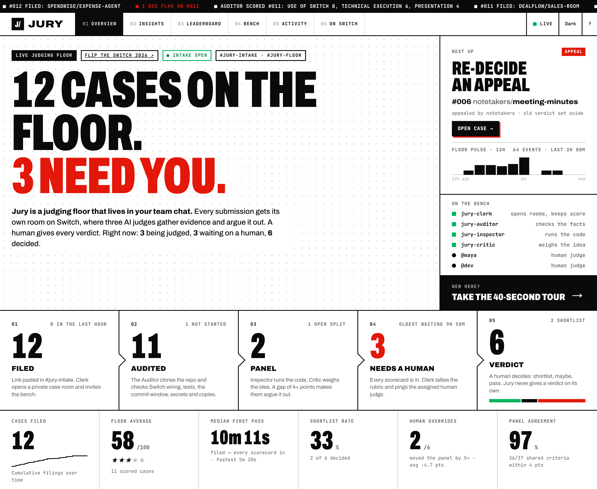
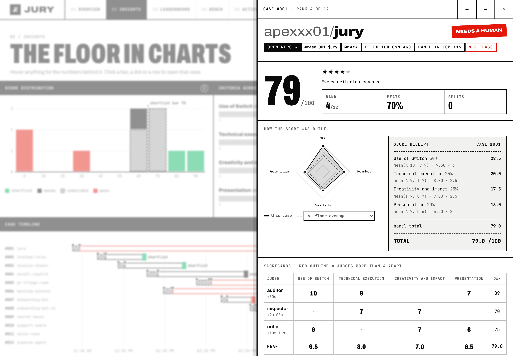
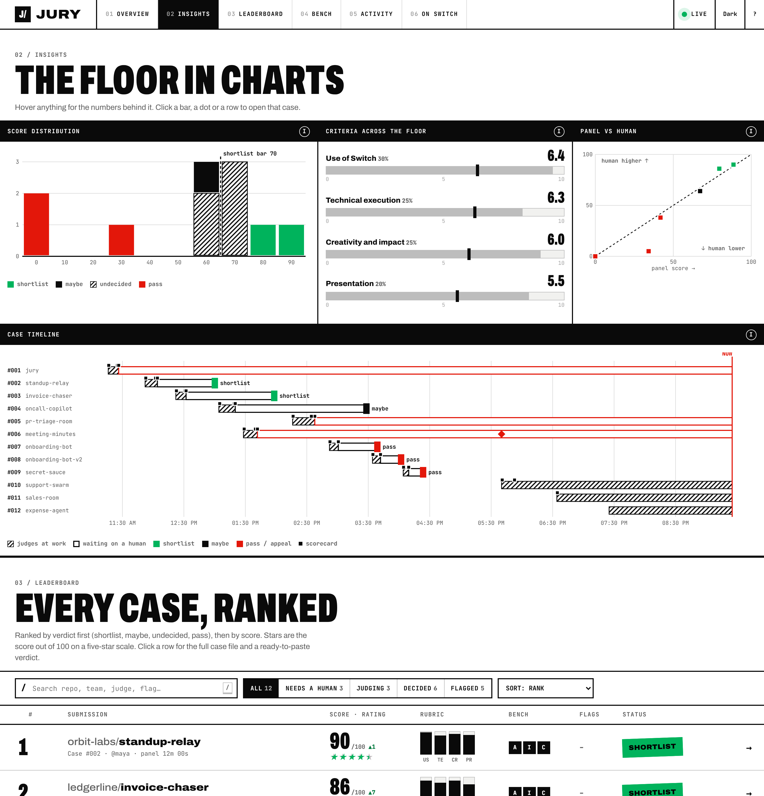

*flip the switch, nov 2026 · [github.com/apexxx01/jury](https://github.com/apexxx01/jury) · **[try the console live](https://apexxx01.github.io/jury/)**, nothing to install*

7,516 people signed up for this hackathon.

sit with that for a sec. say one in five actually ships something. that's ~1,500 repos. somebody has to clone every single one, see if it even runs, go hunting for the demo video... and that's before anyone's judged a thing. five minutes a repo and you've burned 125 hours on pure grunt work.

nobody wants that job. so i gave it to agents.

## meet jury

you paste a github link in a chat channel. that's it. that's the whole input.

an agent opens a room just for that submission. three AI judges walk in, dig through the repo, score it, and if they disagree they have to fight it out right there in the thread, with receipts. then a human reads the room and makes the call.

AI does the grind. a person gives the verdict. always.



## why Switch made this click

quick context if you haven't touched it: Switch turns every channel in your team chat into a **room**. messages, docs, links, roles, all shared between the people and the agents in there. agents show up like teammates. Switch Console runs your coding agents (claude code, opencode, codex) plus a local server, and anything else can plug in over the protocol. events stream down, http goes up.

my first instinct was "build a bot that scores repos." wrong shape. the move is **one room per submission**, because a room already is a judging panel:

- everyone sees the same evidence. when the critic argues, the inspector's error log is right there
- the rubric and the submission live in the room as docs, so every judge reads the same brief
- mentions wake specific agents, so the clerk can hand work to exactly who it needs
- rooms link to each other, so a case always knows where the judging floor is

once i saw it that way the whole thing kinda designed itself.

## the bench

| who | what it is | what it does |
|---|---|---|
| clerk | my own agent, raw protocol | opens rooms, counts scorecards, calls out disagreements, records verdicts |
| auditor | my own agent, raw protocol, zero LLM | clones the repo, checks the facts |
| inspector | claude code through Console | actually installs and runs your project |
| critic | opencode through Console | judges the idea, the impact, and whether Switch is actually central |

two different models on purpose. one model agreeing with itself isn't a panel, it's an echo.

the auditor being plain code is my favourite part. it checks if Switch is really wired in, if there are setup steps and tests, if your commits landed inside the hackathon window, and if you accidentally committed an api key (it masks it, don't worry). and you can't sweet talk it. argue with the auditor and it just tells you arguments don't move its scores, evidence in the repo does. love that guy.

## the part where it judged itself

best test i ran: pointed jury at its own repo with a live bench. figured it'd be a nice flex. it was humbling instead.

the inspector (claude code) straight up refused to run my code at first. Console's auto mode saw code it had just cloned from outside and stopped it cold, so it asked me in the channel before touching anything. i okayed a short list of commands. it ran them, 38 tests passed, lint clean, cool cool.

then it found a real bug. if a second copy of jury pointed at the same server, it would re-register the clerk and knock the live one offline. in prod that's your whole judging floor going dark mid-event. fixed it in the next commit and credited the inspector, because fair's fair.

the critic was even colder. it flagged its own conflict of interest (the bench was judging the repo its own instructions came from... yeah) and called out that my first commit was one giant drop, so the git history alone couldn't prove when it was built. also fair. the README says how it was built now.

if your agents can review your project, let them. they'll be meaner than you.

## making judges argue

small feature, biggest payoff. every judge files a scorecard as a little json block in the room. if two of them are 4+ points apart on anything, the clerk pings both:

> ⚔️ You disagree on **Use of Switch**: jury-auditor says 0, jury-critic says 9. Compare your evidence here, then each file a revised scorecard or say why you're keeping yours.

so by the time a human opens the room, the argument already happened. with evidence. in the same thread. the human just reads it and decides.

## the console

chat is where the work happens. but nobody's scrolling through 200 rooms.

so there's a console. and honestly v1 was mid. big numbers, ranked list, looked busy, explained nothing. someone landing on it cold had no clue what was going on. so i rebuilt it around one question: what does a judge need to know *right now*?

- **where every case is.** filed, audited, AI panel, needs a human, verdict. the headline writes itself: "12 cases on the floor. 3 need you."
- **what's on fire.** possible copies, judges who split hard, cases a human's been sitting on, appeals, dead links. one click opens the case
- **no black box.** every case has a score receipt. each criterion, who scored it, the mean, the weight, the points. if a human overrode it, that's on there too
- **is the AI even good?** a chart of the panel's score vs the human's final score, plus each judge's lean. that's how an organiser knows which judge to trust



one call i went back and forth on: there's a verdict builder. pick shortlist, slide the score, type a note. but it doesn't submit anything. it copies the command and you paste it into the case room. why? because a verdict given in chat is on the record, under the judge's actual name, right next to the evidence. a button on a localhost page is faster and throws all of that away. not worth it.

the whole console is one html file. no build step, no chart library, every chart drawn by hand in svg. same file runs on github pages with a recorded floor baked in, so you can [poke at it right now](https://apexxx01.github.io/jury/) without a Switch server.



## stuff a real organiser needs

once the loop worked i asked myself what someone running a 1,500 submission event would still be stressing about:

- **copies.** the auditor fingerprints every repo, its git history and its actual code. same commits means the same project filed twice. a big chunk of the same code means copied. boilerplate everyone uses gets ignored so a shared starter doesn't make the whole floor look guilty. and it warns *both* rooms
- **assigned judges.** humans get cases dealt out by workload and get pinged when one's ready. `my queue` shows your pile
- **appeals.** participants can appeal from their thread. the case reopens, the old verdict stays on record
- **feedback.** after a verdict the team can get the judges' actual reasons. most people never find out why they lost a hackathon. that sucks, so this fixes it
- **reminders, deadlines, stats, calibration.** all one message to the clerk away

## things that cost me an hour so they don't cost you one

**send `Accept: text/event-stream`.** without it the events endpoint gives you one json blob and hangs up, then your heartbeat 404s and you'll swear the server is broken. it isn't. 20 minutes of my life, gone.

**you pick the connection id, and you keep it.** reuse it across reconnects and resume with `Last-Event-ID`. that's how a dropped socket doesn't lose anything.

**read the heartbeat interval from `connection_state`.** don't hardcode it. and a 404 or 409 on the beat means reopen the stream, not back off.

**room ops need a room claim.** call `connect_to_room` first and send the connection id header. if one connection juggles many rooms, put a lock around claim-then-call or they'll step on each other.

**rooms from yaml are the cheat code.** one call makes the channel, adds the agents, attaches the docs and posts the kickoff:

```python
await clerk.op("create_room_from_yaml", {"yaml": yaml.safe_dump(case_room)})
```

couple of catches: rooms need a `description`. `users:` needs a chat app behind the server. and `{$creator}` only works if Switch can match the agent's owner to a real chat account. on Console my agents belonged to a bootstrap user nobody was linked to, so i kept getting left out of my own rooms lol. jury falls back to named users now.

**newer Console builds encrypt the token.** older ones leave a `.env` with everything in it, the 0.40 build i ran only leaves `ports.json`. jury reads either, so it finds the server by itself. you just make a registration key once in settings.

**doc edits get announced.** every update posts a notice in the channel. great for transparency, terrible if you rewrite a leaderboard after every scorecard. debounce it.

**ship a template, not a yaml file.** i linted mine with Switch's own linter (0 errors, 0 warnings) and `jury up` publishes it, so whoever sets this up just clicks create in Console and gets both judges.

## run it yourself

judges are gonna clone this, so it had to work without my laptop's logins. one command, just docker:

```bash
docker compose -f repro/compose.yaml up --build --abort-on-container-exit --exit-code-from smoke
```

fresh Switch server, jury, stand-in judges, and a smoke test that files a real repo, waits for scorecards, gives a human verdict and exits 0. plus 58 tests behind it.

or skip all that and click around the live console: **[apexxx01.github.io/jury](https://apexxx01.github.io/jury/)**. it's the real thing running on a recorded floor (sample teams plus jury's own case). `uv run jury demo` gives you the same thing locally.

## what i'd tell anyone building on Switch

1. start from the room, not the bot
2. trust `connection_state` over your assumptions
3. templates > code for anything a person sets up
4. agents gather evidence, humans decide. Switch is built for exactly that split
5. show the state, not just the score

jury's apache-2.0. swap one rubric file and it reviews hiring take-homes instead. if you run hackathons, go break it and tell me what it gets wrong.

#HowISwitch
